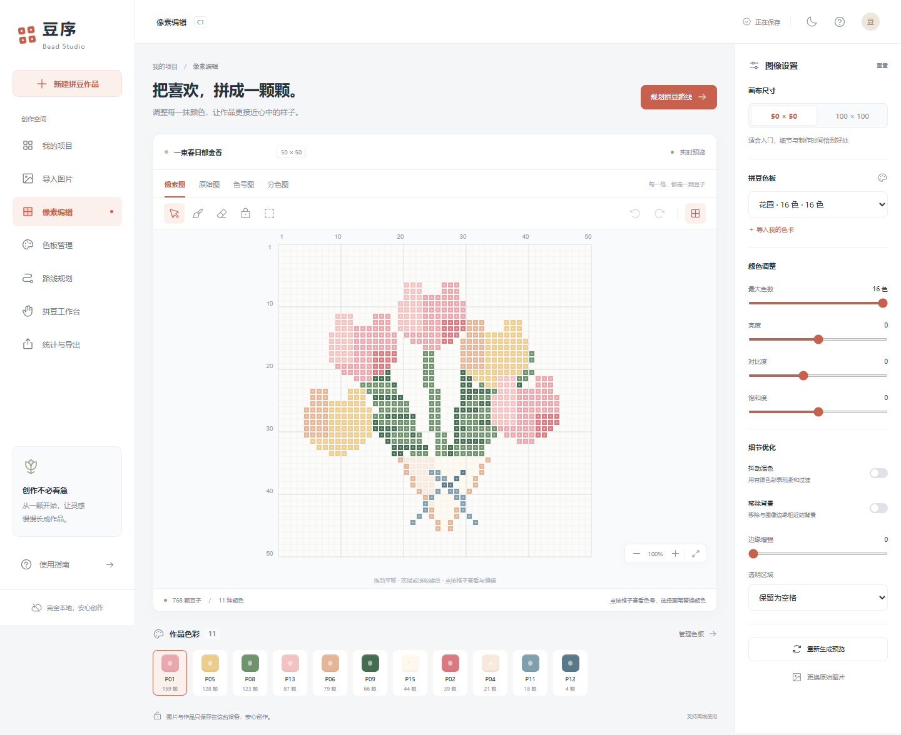

# 星子拼豆 Xingzi Beads

> 本地优先的拼豆工作室：照片/图纸转 50×50 或 100×100、专属色板、感知色差匹配、科学路线和逐豆制作。无账号、无后端、无遥测。

## 先运行

Windows 可双击 `启动星子拼豆.cmd`。命令行：

```bash
npm ci
npm run dev:all
```

应用 `http://localhost:5173`，官网 `http://localhost:5174`。构建静态发布目录：`npm run build:release`，输出 `release-site/`。

## 后续维护

产品名、版本、发布日期和更新日志只改 `product.config.json`。官网改 `website/src/site.tsx` / `website/src/site.css`；安装、备份和更新改 `src/features/distribution/`；原有转换、色板、路线和页面仍在原模块。完整修改索引见 [实操附录](docs/04-practical-appendix.md)，跨端构建见 [分发指南](docs/08-distribution-guide.md)。

本项目是一个完全本地运行的拼豆辅助 PWA：照片或图纸在浏览器 Worker 中转换为 50×50 / 100×100 像素图，所有非空格子都来自当前色板。路线按**颜色总面积降序**，同一种颜色的全部豆子连续完成，再处理下一种颜色；颜色内部优先较大的四邻接连通块。



## 运行

```bash
npm install
npm run dev
```

打开终端显示的 `http://localhost:5173`。生产构建使用 `npm run build`，预览使用 `npm run preview -- --host 0.0.0.0`。应用没有后端、账号、广告、远程字体或云端图像接口；图片、色板、项目、路线和进度保存在浏览器 IndexedDB。首次访问后由 PWA 缓存支持离线启动，手机相机和安装 PWA 通常需要 HTTPS 或 localhost。

## 用户色卡

在“色板管理”中上传 PNG/JPG/WebP 色卡，Worker 会提取平坦色块；也可以导入 JSON 精确色号。建议使用实物色卡在均匀光线下拍摄，提取后逐色校对。JSON 最小格式：

```json
{"name":"我的色卡","colors":[{"code":"A01","name":"樱花粉","hex":"#E8A3AD"}]}
```

应用导出的项目备份会嵌入来源图片、色板快照、网格、路线和进度，可在另一台设备离线恢复。导入时会为色板和项目建立新的本地身份，同时保留颜色 ID，避免覆盖已有项目的共享色板。

## 术语帮助与快速导航

右上角放大镜打开本地词典和解释偏好；普通状态只显示问号入口，不会弹出引导。新手、标准、专家模式及完全关闭解释入口均在本机记忆。专家可长按名词或主动搜索。拼豆工作台底边的步骤胶囊支持连续长按、跳步、滑动、断点、框选/圈选批量标记和单次撤销。**长按前进会将经过的豆子记为完成，松手后定位下一颗未完成豆；滑条向前拖动实时标记经过的豆子，向回滑会撤回这段滑动新增的标记，保留原先已完成的豆子。**松手后继续拖动也能回退，每次松手均可单次撤销/重做；Esc、指针取消或窗口失焦恢复本次拖动前状态。滑动依据随最近80条导航历史保存；手动标记或其他导航操作建立新基线。长按后退只改变查看位置。点格重复确认幂等，标记后自动跳到下一未完成豆。

运行 `npm run test:features` 验证新增真实浏览器流程，包括断网首次使用词典、快进与撤销、移动端解释/工作台并用。更新词典后执行 `npm run glossary:index` 刷新轻量工具提示索引。

## 已知边界

颜色匹配使用 sRGB → Lab(D65) → CIEDE2000；附件示例色卡是压缩图片取样，标记为参考值，不代表任何品牌官方色值。背景去除是边界相似色泛洪，图纸网格检测是周期线启发式，不是语义抠图或 OCR。局部重算目前会在 Worker 中重新采样完整图像，再只写回选区；界面转换耗时包含解码与裁剪。“少移动”可以调整同色内部的块顺序，三种模式的颜色总面积顺序与整色连续约束相同。桌面基准用于回归，不能替代每种手机上的 60fps 保证；Capacitor/Tauri 封装可在构建产物上另行完成。

## 验证

`npm test` 覆盖颜色数学、50/100 网格、色板闭包、抖动与锁定、三种严格同色路线、覆盖校验、IndexedDB、备份校验、解释词典和导航增量历史。`npm run build` 验证 TypeScript、Vite 和 PWA 产物。完整结果见 [docs/03-verification.md](docs/03-verification.md)，新功能结构与交互见 [docs/05-optional-help-and-navigation.md](docs/05-optional-help-and-navigation.md)。

运行 `npm run preview` 后，可在另一终端用 `npm run test:e2e` 验证基础浏览器流程，也可运行 `npm run test:features` 验证解释与导航交互。测试首次使用需 `npx playwright install chromium`，也可设置 `PLAYWRIGHT_CHROMIUM_EXECUTABLE`。目录结构与完整算法伪代码在产品方案中，维护入口与部署步骤见 [实操附录](docs/04-practical-appendix.md)。

开发模式另可运行 `npm run test:image-flow`（默认访问 `http://localhost:5173`），检查导入、原图/像素图、路线切页和手机窄屏的 Canvas 实际像素，覆盖 React StrictMode 重挂载的显示回归。
